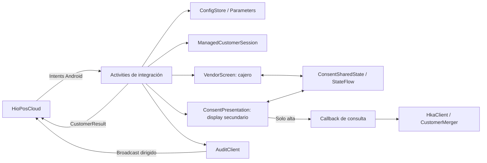
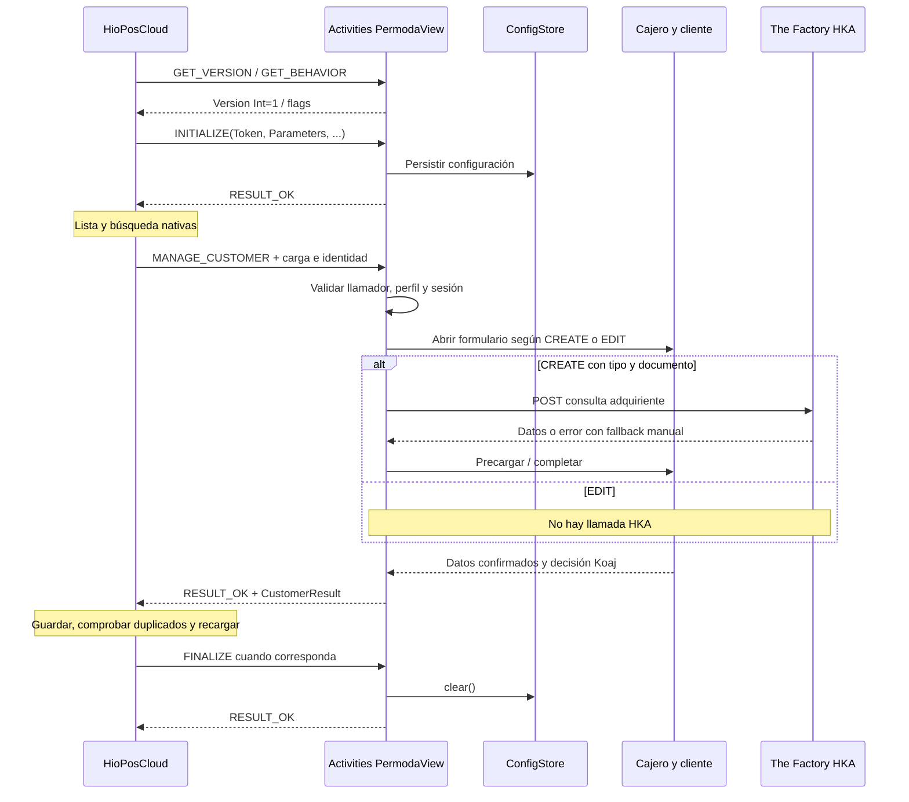

# Guía técnica de desarrollo e integración de PermodaView

Estado documentado: **15 de octubre de 2026**. Esta guía describe el código actual, las decisiones de integración y las evidencias de las auditorías corregidas. Está dirigida a quien deba mantener el módulo, preparar una terminal e integrar el flujo de clientes con HioPosCloud.

## Índice

1. [Estado y alcance de la evidencia](#estado)
2. [Negocio y reglas de clientes](#negocio)
3. [Arquitectura y mapa del proyecto](#arquitectura)
4. [Protocolo de intents con HioPosCloud](#intents)
5. [Contrato ManageCustomer y ejemplos completos](#manage)
6. [Configuración y precedencia](#configuracion)
7. [HKA, DIAN y documentos](#hka)
8. [Pantallas, estado y ciclo de vida](#pantallas)
9. [Seguridad, auditoría y datos sensibles](#seguridad)
10. [Compilación, firma, versiones y ADB](#compilacion)
11. [Pruebas y QA](#pruebas)
12. [Registro de hallazgos y rectificaciones](#hallazgos)
13. [Validación en terminal y diagnóstico](#terminal)
14. [Cómo continuar el desarrollo](#mantenimiento)
15. [Glosario](#glosario)
16. [Fuentes y documentos de apoyo](#fuentes)

<a id="estado"></a>
## 1. Estado y alcance de la evidencia

La implementación local de **ManageCustomer está terminada**. La lista, la lupa y la búsqueda pertenecen al POS; PermodaView abre su formulario para crear o editar clientes. Se generaron APK dev y release con **versionName="1", versionCode=1 e ICG_MODULE_VERSION=1**, fijos y sin incrementos automáticos.

El APK dev es depurable y está firmado con el certificado habitual de la aplicación. La release usa ese mismo certificado y no es depurable. No se ha conectado un terminal, ejecutado ADB, instalado, publicado en CloudLicense ni probado servicios de negocio durante estas fases locales. Una compilación, un XML válido o RESULT_OK no prueban persistencia en Cloud.

Hay cuatro clases de evidencia que no deben mezclarse:

| Evidencia | Qué establece | Qué no establece |
|---|---|---|
| Código y pruebas actuales | Comportamiento local del adaptador, UI y reglas de dominio | Cómo invoca o guarda el POS nuevo |
| PDF 0.6.4 ultimate | ManageCustomer, campos y CustomerSearch | Todos los literales del extra de entrada o la señal externa de operación |
| APK POS histórico 14.20.0.0, código 1131 | Editor nativo antiguo, IDs provisionales y parser anterior | Implementación de MANAGE_CUSTOMER, que ese APK no contiene |
| Compatibilidad del terminal actual confirmada por el usuario | La instalación objetivo soporta ManageCustomer | Que ya se hayan capturado sus extras o validado esta entrega en ella |

El perfil de entrada configurable aísla lo que falta contrastar. No se inventa un extra universal, un CustomerMode contractual ni un IsNew de cliente. La ausencia de terminal no impidió desarrollar y verificar localmente; delimita la fase de aceptación pendiente.

<a id="negocio"></a>
## 2. Negocio y reglas de clientes

PermodaView es un módulo Android de documento de **Permoda** para **HioPosCloud/ICG**. Consulta datos del adquiriente mediante **The Factory HKA**, permite completar datos de contacto y presenta **Koaj Lovers** en la pantalla del cliente. No implementa un buscador del maestro, un backend de clientes ni una conexión directa a la base Cloud del POS.

| Operación | Responsable de entrada | Comportamiento del módulo |
|---|---|---|
| Consultar, usar lupa o seleccionar existente | POS nativo | No abre formulario propio |
| Crear cliente | POS llama MANAGE_CUSTOMER | Captura documento si falta, consulta HKA y permite completar manualmente |
| Identificación inexistente y respuesta No | POS nativo | No debe invocar el alta del módulo |
| Identificación inexistente y respuesta Sí | POS llama alta con documento precargado | No repite la pregunta de crear ni la captura ya disponible |
| Editar ficha | POS llama con identidad positiva | Abre datos existentes, permite corregir y no consulta HKA |
| Consumidor final | POS nativo | No sustituye una ficha gestionada por un genérico |

La operación alta/edición queda congelada al comenzar. Cambiar la cédula de un cliente existente no lo convierte en un alta. El ID persistido, el documento editable y el criterio de duplicados son tres conceptos separados.

### Categoría y Koaj Lovers

| Categoría original | Decisión o condición | Categoría final |
|---|---|---|
| Normal | Cliente acepta | VIP |
| Normal | Cliente declina | Normal |
| Normal | Timeout, Koaj apagado o cajero continúa sin inscripción | Normal |
| VIP | Acepta, declina o no responde | VIP |
| Empleado | Cualquier respuesta | Empleado; no se ofrece cambiar a normal |

El cajero confirma los datos; esa confirmación no es el consentimiento de Koaj. **Continuar sin inscripción** resuelve con decisión `null`: no emite una aceptación ni un rechazo atribuido al cliente. DECLINED y TIMEOUT son eventos diferentes aunque ambos produzcan `optIn=false`. La revocación explícita de una membresía VIP existente no está implementada ni definida por la pantalla actual; un No no degrada al cliente.

`customerTypeId` es categoría comercial. `contactTypeId` expresa naturaleza de persona en el APK histórico: 1 natural, 2 jurídica. `allowPromos` es un permiso comercial independiente. No se convierte la aceptación de Koaj en un cambio de naturaleza fiscal ni en aceptación de promociones.

<a id="arquitectura"></a>
## 3. Arquitectura y mapa del proyecto

Aplicación Kotlin/Android con vistas XML, AppCompat y una `Presentation` para el display secundario. No usa Compose ni un servicio propio de persistencia de clientes. El único módulo Gradle es `:app`.



Las rutas de la tabla son relativas a la raíz del proyecto. Los enlaces abren el código real.

| Archivo o directorio | Responsabilidad |
|---|---|
| [PermodaViewApp.kt](../app/src/main/kotlin/com/permoda/facturacion/PermodaViewApp.kt) | Application y acceso diferido a ConfigStore |
| [AndroidManifest.xml](../app/src/main/AndroidManifest.xml) | Activities exportadas, acciones, queries y provider |
| [ApiActions.kt](../app/src/main/kotlin/com/permoda/facturacion/entry/ApiActions.kt) | Namespace, extras, flags y helpers de respuesta/confianza |
| [entry](../app/src/main/kotlin/com/permoda/facturacion/entry) | Handshake, gestión, compatibilidad y driver |
| [ManageCustomerActivity.kt](../app/src/main/kotlin/com/permoda/facturacion/entry/ManageCustomerActivity.kt) | Valida llamada, carga XML, crea sesión, une UI/HKA y devuelve resultado |
| [ManageCustomerContract.kt](../app/src/main/kotlin/com/permoda/facturacion/core/manage/ManageCustomerContract.kt) | Perfil, categorías remotas, identidad, parser y serializer nuevos |
| [ManageCustomerTransport.kt](../app/src/main/kotlin/com/permoda/facturacion/core/manage/ManageCustomerTransport.kt) | Lectura String/URI autorizada y acotada |
| [ManagementStart.kt](../app/src/main/kotlin/com/permoda/facturacion/core/manage/ManagementStart.kt) | Enrutamiento inicial puro, compartido con pruebas |
| [config](../app/src/main/kotlin/com/permoda/facturacion/core/config) | SharedPreferences, ParamMap y CallerPolicy |
| [CustomerData.kt](../app/src/main/kotlin/com/permoda/facturacion/core/model/CustomerData.kt) | Datos inmutables usados por la interfaz |
| [CustomerTypeResolver.kt](../app/src/main/kotlin/com/permoda/facturacion/core/customer/CustomerTypeResolver.kt) | Reglas de membresía y proyección de categoría |
| [hka](../app/src/main/kotlin/com/permoda/facturacion/core/hka) | HTTP, respuesta, merge, tipos documentales y auditoría |
| [loyalty](../app/src/main/kotlin/com/permoda/facturacion/core/loyalty) | Configuración, resultados y auditoría Koaj |
| [ConsentSharedState.kt](../app/src/main/kotlin/com/permoda/facturacion/core/consent/ConsentSharedState.kt) | Estado compartido entre pantallas y comandos de un uso |
| [ConsentPresentation.kt](../app/src/main/kotlin/com/permoda/facturacion/presentation/display/ConsentPresentation.kt) | Orquestación, consulta, transiciones y cierre del display |
| [ConsentScreen.kt](../app/src/main/kotlin/com/permoda/facturacion/presentation/consent/ConsentScreen.kt) | Espejo del cliente, validación visual y Koaj |
| [VendorScreen.kt](../app/src/main/kotlin/com/permoda/facturacion/presentation/vendor/VendorScreen.kt) | Captura y edición por el cajero, teclado y estado |
| [CustomerValidator.kt](../app/src/main/kotlin/com/permoda/facturacion/core/validation/CustomerValidator.kt) | Reglas puras de campos obligatorios |
| [Xml.kt](../app/src/main/kotlin/com/permoda/facturacion/core/Xml.kt), [ModifyDocumentXml.kt](../app/src/main/kotlin/com/permoda/facturacion/core/modify/ModifyDocumentXml.kt) | Codecs históricos; no son el adaptador ManageCustomer |
| [res](../app/src/main/res) | Layouts, temas, paleta, recursos y strings |
| [src/test](../app/src/test/kotlin/com/permoda/facturacion) | Pruebas JVM |

Hay comentarios históricos en modelos, enums y UI que aún mencionan ModifyDocument, compuertas antiguas o elección de empleado. Para el flujo vigente prevalecen las ramas `managedOperation`, el contrato nuevo y `CustomerTypeResolver`. Esos comentarios no amplían el contrato del POS.

<a id="intents"></a>
## 4. Protocolo de intents con HioPosCloud

### Identidades y dirección de comunicación

- Paquete Android: `com.permoda.facturacion`.
- `apk_name` ICG vigente: `custvalidation`.
- Namespace de acción: `icg.actions.document.custvalidation.`.
- POS principal conocido: `icg.android.start`; también se admite `com.icg.hiopos` como llamador release.
- HioPosCloud inicia la Activity del módulo para obtener resultado. La aplicación no necesita iniciar una Activity del POS para devolverlo: usa `setResult(...)` y `finish()`.
- El Intent de respuesta conserva exactamente la acción recibida. Los nombres de extras y sus tipos forman parte del contrato; no intercambiar Int, Boolean y String.

`PERMODA_ICG_APK_NAME` permite cambiar el namespace al compilar, pero no debe modificarse sin coordinar CloudLicense. El placeholder del manifiesto y `BuildConfig.ICG_APK_NAME` salen del mismo valor. Un nombre distinto puede hacer que el POS interprete que el módulo no está instalado aunque el paquete exista.

### Tabla completa de acciones declaradas

Todas las acciones siguientes llevan el prefijo anterior y filtros `android.intent.category.DEFAULT`.

| Sufijo | Activity | Entradas usadas hoy | Salida efectiva | Verifica llamador |
|---|---|---|---|---|
| INITIALIZE | InitializeActivity | `Token`: String no vacío; `Parameters`: String no vacío; `Shop` y `License`: String opcionales | RESULT_OK + STATUS=OK; entrada inválida/excepción: RESULT_CANCELED + STATUS=CANCELLED y ErrorMessage | Sí |
| GET_VERSION | GetVersionActivity | Sin datos requeridos | RESULT_OK, STATUS=OK, **Version Int=1** | No |
| GET_BEHAVIOR | GetBehaviourActivity | Sin datos requeridos | RESULT_OK y flags tipados; este handler no añade STATUS | No |
| SHOW_SETUP_SCREEN | SetupScreenActivity | Lee ShopId/PosId como String e isReadOnly como Boolean; no aplica Parameters localmente | RESULT_OK + STATUS=OK; sin UI de ajustes | No |
| MANAGE_CUSTOMER | ManageCustomerActivity | Perfil XML/URI e identidad descritos en sección 5; configuración persistida de INITIALIZE | RESULT_OK + STATUS=OK + CustomerResult String; cancelación/error: RESULT_CANCELED + STATUS=CANCELLED/ERROR + ErrorMessage | Sí; también valida action |
| SELECT_CUSTOMER | CustomerSelectionActivity | No procesa cliente | RESULT_CANCELED + STATUS=CANCELLED; selección nativa | Sí |
| MODIFY_DOCUMENT | CustomerSelectionActivity | No procesa Document/DocumentUri | RESULT_CANCELED + STATUS=CANCELLED; handler de compatibilidad sin formulario | Sí |
| FINALIZE | FinalizeActivity | Sin datos requeridos | Limpia ConfigStore; RESULT_OK + STATUS=OK. Llamador no autorizado: cancelación | Sí |

Los puntos de implementación están en [entry](../app/src/main/kotlin/com/permoda/facturacion/entry). GET_VERSION, GET_BEHAVIOR y SHOW_SETUP_SCREEN son entradas informativas/configurativas sin la comprobación de CallerPolicy que sí protege las escrituras indicadas. No afirmar que todas las Activities exportadas la aplican. Las demás entradas se resuelven por filtro; únicamente ManageCustomer comprueba explícitamente su acción dentro del handler actual.

`ModuleInfoActivity` es el launcher de ficha técnica, exportado con MAIN/LAUNCHER. `TestDriverActivity` no está exportada y se abre desde la ficha solo en debug. Ninguna es una acción de Document API.

### Handshake y flags

INITIALIZE guarda Token y Parameters en SharedPreferences privadas llamadas `permodaview`. Shop y License solo se sustituyen cuando llegan no vacíos. `snapshot()` entrega `ModuleConfig`; `isInitialized` exige Token y Parameters no vacíos. INITIALIZE no valida en ese momento todos los parámetros de categorías: esa validación ocurre al abrir ManageCustomer. FINALIZE borra las preferencias; el siguiente flujo requiere reinicialización/configuración apropiada.

GET_VERSION devuelve `Version` como **Int**, no la cadena VERSION_NAME. Históricamente devolver String hacía que `getIntExtra` del POS obtuviera su fallback y pidiera reinstalar el módulo. Aunque todos los números actuales sean 1, los tipos siguen siendo diferentes.

GET_BEHAVIOR devuelve:

| Clave exacta | Tipo / valor |
|---|---|
| ManageCustomer | Boolean true |
| CallOnCustomerSelection | Boolean false |
| CreateUpdateCustomer | Boolean false |
| CanContinue | Boolean true |
| canAudit | Boolean true; respetar c minúscula |
| IfProductNotExists | Int 3; no Boolean |

Son false: `CallBeforeTotalizeSale`, `CallBeforeTotalizePurchase`, `CallBeforeTotalizeOrder`, `CallBeforeFinalizeStockAdjustment`, `CallBeforeFinalizeTransfer`, `CallBeforeSetOnHold`, `CallOnTotalizationCanceled`, `CallOnDocumentCanceled`, `CallBeforePrint`, `FixPricelist`, `CanShowAsSaleHeaderOption`, `CallOnTotalizeSaleAfterMixAndMatch`, `CallAfterCreate`, `CallVoidDocument`, `CallOnSubtotal` y `RemoveCustomer`. CreateUpdateCustomer pertenece a la ruta histórica ModifyDocument; no se activa para implementar ManageCustomer.

Tras instalar o cambiar configuración, el POS debe refrescar GET_BEHAVIOR e INITIALIZE. Conservar handlers antiguos permite resolver llamadas de una instalación con behaviour obsoleto, pero su cancelación **no constituye un fallback automático** al buscador nativo. Hay que corregir/refrescar el handshake.

### Secuencia de referencia

El orden concreto de las consultas de arranque depende del POS; el diagrama muestra las responsabilidades, no impone un orden universal de handshake.



<a id="manage"></a>
## 5. Contrato ManageCustomer y ejemplos completos

### 5.1 Qué está documentado y qué es configurable

El PDF nuevo establece `ManageCustomer=true`, la acción MANAGE_CUSTOMER, los campos del cliente y la respuesta CustomerResult con CustomerSearch. No proporciona todos los literales del transporte de entrada. El lector genérico de **resultados** del APK antiguo conoce CustomerResult/CustomerResultUri/CustomerResultPath; eso no demuestra qué extra envía el POS nuevo al invocar ManageCustomer.

El adaptador actual adopta una convención explícita, ajustable por Parameters:

| Parámetro | Valor inicial | Qué permite cambiar |
|---|---|---|
| MANAGE_CUSTOMER_INPUT_EXTRA | CustomerResult | Nombre del extra String con XML entrante |
| MANAGE_CUSTOMER_INPUT_URI_EXTRA | CustomerResultUri | Nombre del extra Parcelable Uri |
| MANAGE_CUSTOMER_ID_EXTRA | customerId | Nombre del extra de identidad |
| MANAGE_CUSTOMER_DOCUMENT_CODES | HIOPOS | Dominio de códigos numéricos: HIOPOS o DIAN |

Los tres nombres de extra deben ser distintos y cumplir `[A-Za-z][A-Za-z0-9_]{0,79}`. Cambiar un nombre no adapta automáticamente una estructura XML distinta ni una señal de operación diferente. Si la versión real usa otro esquema, habrá que adaptar el borde y sus pruebas, sin adivinar la operación en la UI.

Se admite exactamente una carga: String **o** Uri. Recibir ambas se rechaza; no hay precedencia silenciosa. La Uri debe ser `content://<callingPackage>.provider/...`, con acceso concedido por el POS. No se aceptan file://, rutas de disco, Intent.data ni CustomerResultPath. El propio FileProvider de PermodaView sigue declarado para compatibilidad histórica, pero el flujo nuevo no lo usa para escribir su respuesta.

El transporte lee como máximo 256 KiB más un byte de detección y cierra el stream. El parser vuelve a comprobar el tamaño UTF-8, rechaza DTD/ENTITY y campos duplicados o anidados. Acepta raíz `CustomerResult` o `Customer`, con hijos directos `CustomerField Key="..."`. Los nombres son sensibles a mayúsculas. No acepta un Document conteniendo Customer ni CustomerSearch como hijo de **entrada**: CustomerSearch se genera en la salida. El formato es deliberadamente asimétrico.

### 5.2 Identidad, alta y edición

Se exige un ID numérico de 64 bits en `CustomerField Key="customerId"` o en el extra configurado, cuyo tipo Android puede ser Int, Long o String numérico. Si llegan ambos deben coincidir. Un Boolean, un nombre, un XML sin identidad o IDs contradictorios se rechazan antes de consultar HKA.

| ID entrante | Operación local | ID de salida |
|---|---|---|
| Mayor que 0 | EDIT | Siempre el original, aunque la UI cambie documento u otro ID |
| 0 o negativo | CREATE | Se omite; nunca se propaga un ID provisional |
| Ausente/inválido/contradictorio | Error | No se acepta la ficha ni se consulta HKA |

En el editor nativo histórico, nuevo y nuevo desde fiscalId usan `customerId=-1`; después el editor puede generar -2, -3, etc. Esto respalda tratar los negativos como provisionales. **No demuestra que el nuevo Intent externo entregue ese mismo extra**: ese punto sigue pendiente de contraste.

Nombre, correo, documento, CustomerSearch y `CustomerMode` no deciden CREATE/EDIT. Las menciones `IsNew` en los PDF corresponden a líneas de documento; no son un indicador documentado de cliente nuevo. `CustomerMode` se conserva únicamente para QA histórico.

### 5.3 Catálogo comercial remoto

Son obligatorios `CUSTOMER_TYPE_NORMAL_ID`, `CUSTOMER_TYPE_VIP_ID` y `CUSTOMER_TYPE_EMPLOYEE_ID`: enteros no negativos y distintos. No hay defaults de catálogo. La edición debe traer categoría conocida; si falta o no está mapeada, se rechaza. El alta sin categoría usa el normal configurado; un alta con categoría desconocida también se rechaza.

El enum interno utiliza 0 normal, 1 VIP y 2 empleado. Esos valores solo sirven al modelo/UI. La sesión traduce entrada remota a enum y vuelve a traducir el resultado al catálogo real. El APK histórico declara STANDAR=1; esto prueba que no es seguro enviar 0/1/2 como catálogo universal. Los IDs reales del tenant no se obtuvieron en esta tarea.

### 5.4 Configuración sintética completa para los ejemplos

Los números 10/47/81 son **ficticios**, no configuración de producción. HKA está apagado explícitamente para que estos ejemplos no consulten servicios. La estructura es compatible con ParamMap; no es un mensaje para enviar a un terminal desde esta guía.

```xml
<Configuration><Parameters>
  <Param Key="CUSTOMER_TYPE_NORMAL_ID">10</Param>
  <Param Key="CUSTOMER_TYPE_VIP_ID">47</Param>
  <Param Key="CUSTOMER_TYPE_EMPLOYEE_ID">81</Param>
  <Param Key="MANAGE_CUSTOMER_INPUT_EXTRA">CustomerResult</Param>
  <Param Key="MANAGE_CUSTOMER_INPUT_URI_EXTRA">CustomerResultUri</Param>
  <Param Key="MANAGE_CUSTOMER_ID_EXTRA">customerId</Param>
  <Param Key="MANAGE_CUSTOMER_DOCUMENT_CODES">HIOPOS</Param>
  <Param Key="HKA_ENABLED">false</Param>
  <Param Key="HKA_AUDIT_ENABLED">false</Param>
  <Param Key="KOAJ_ENABLED">true</Param>
  <Param Key="KOAJ_ALLOW_DECLINE">true</Param>
  <Param Key="KOAJ_TIMEOUT_MS">0</Param>
  <Param Key="KOAJ_AUDIT_ENABLED">false</Param>
</Parameters></Configuration>
```

### 5.5 Entrada de alta con documento precargado

Cadena en el extra configurado CustomerResult, sin extra Uri simultáneo. Todos los datos son sintéticos.

```xml
<CustomerResult>
  <CustomerField Key="customerId">-1</CustomerField>
  <CustomerField Key="customerTypeId">10</CustomerField>
  <CustomerField Key="contactTypeId">1</CustomerField>
  <CustomerField Key="fiscalDocumentType">9</CustomerField>
  <CustomerField Key="fiscalId">12345678</CustomerField>
</CustomerResult>
```

Con perfil HIOPOS, 9 representa CC. La sesión es CREATE aunque traiga documento. Sin nombre/correo/teléfono aún no puede aceptarse el resultado; se completan en el formulario. Si faltan tipo o documento, se abre captura. Tener ambos inicia la consulta/fallback directamente, sin repetir la autorización de crear que ya resolvió el POS.

### 5.6 Entrada de edición

```xml
<CustomerResult>
  <CustomerField Key="customerId">123</CustomerField>
  <CustomerField Key="customerName">Persona Prueba</CustomerField>
  <CustomerField Key="customerTypeId">81</CustomerField>
  <CustomerField Key="contactTypeId">1</CustomerField>
  <CustomerField Key="fiscalDocumentType">9</CustomerField>
  <CustomerField Key="fiscalId">12345678</CustomerField>
  <CustomerField Key="email">persona@example.test</CustomerField>
  <CustomerField Key="phone">3001234567</CustomerField>
  <CustomerField Key="allowPromos">false</CustomerField>
</CustomerResult>
```

La ficha 123 es EDIT y empleado en el mapa sintético. Abre directamente el formulario, sin HKA. Si se corrige el documento a 87654321, el resultado conserva customerId 123 y categoría remota 81.

### 5.7 Resultado y búsqueda de duplicados

Ejemplo de salida de esa edición después de corregir el documento:

```xml
<CustomerResult>
  <CustomerField Key="customerId">123</CustomerField>
  <CustomerField Key="customerName">Persona Prueba</CustomerField>
  <CustomerField Key="customerTypeId">81</CustomerField>
  <CustomerField Key="contactTypeId">1</CustomerField>
  <CustomerField Key="fiscalDocumentType">9</CustomerField>
  <CustomerField Key="fiscalId">87654321</CustomerField>
  <CustomerField Key="email">persona@example.test</CustomerField>
  <CustomerField Key="phone">3001234567</CustomerField>
  <CustomerField Key="allowPromos">false</CustomerField>
  <CustomerField Key="countryIso2">CO</CustomerField>
  <CustomerSearch>
    <CustomerSearchField Key="SearchField">FiscalId</CustomerSearchField>
    <CustomerSearchField Key="SearchValue">87654321</CustomerSearchField>
  </CustomerSearch>
</CustomerResult>
```

El serializer real añade declaración XML y no depende del orden de los campos mostrado aquí. CustomerSearch está **dentro** de CustomerResult. `FiscalId` es el nombre del campo de base de datos; no confundirlo con la clave XML camelCase `fiscalId`. SearchValue usa siempre el documento final. CustomerSearch no consulta el maestro, no identifica alta/edición y no es una API de lookup.

Para un alta, se omite customerId. Si un normal acepta Koaj, customerTypeId sale como 47 bajo el mapa ficticio. La documentación describe control de coincidencias en el POS, pero la política exacta ante una colisión al editar debe verificarse sin sobrescribir otro cliente. Mantener el ID original reduce el riesgo local; no demuestra cómo persistirá el parser nuevo.

### 5.8 Preservación, claves y límites del round-trip

La sesión conserva los campos directos originales y sustituye nombre, documento, tipo documental, correo, teléfono, país y categoría comercial. Conserva `contactTypeId`, `allowPromos`, dirección y demás valores que no edita la UI. Los textos se leen con trim y se reserializan con escape XML: se preserva el valor, no los bytes originales. Si countryIso2 queda vacío usa CO.

Se eliminan metadatos propios de la ruta anterior: `koajLoversOptIn`, `permodaScenario`, `isConsumidorFinal` y `generateInvoice`. El ID original se elimina/reinserta según EDIT/CREATE. La categoría de salida se resuelve desde la categoría original de la sesión y la decisión Koaj, no desde un ID arbitrario que la UI devuelva.

La clave nueva es **customerTypeId** en CustomerField. En la ruta antigua, **CustomerTypeId** PascalCase era interpretado por el POS 14.20 como `contactTypeId`, naturaleza de persona. Se retiró esa escritura comercial del codec histórico. No reutilizar ese writer para el flujo nuevo ni tratar las claves como aliases. El adaptador conserva campos desconocidos literalmente: no armoniza automáticamente aliases antiguos ni una carga que mezcle ambas claves.

La combinación customerTypeId/CustomerResult deriva de las secciones nuevas del PDF; el ejemplo general del documento omite algunos campos nuevos. Su interpretación y persistencia deben validarse en el POS actual. La salida actual es String; no hay fallback de salida a archivo/Uri. Las fichas grandes y campos adicionales deben probarse antes de ampliar el esquema.
